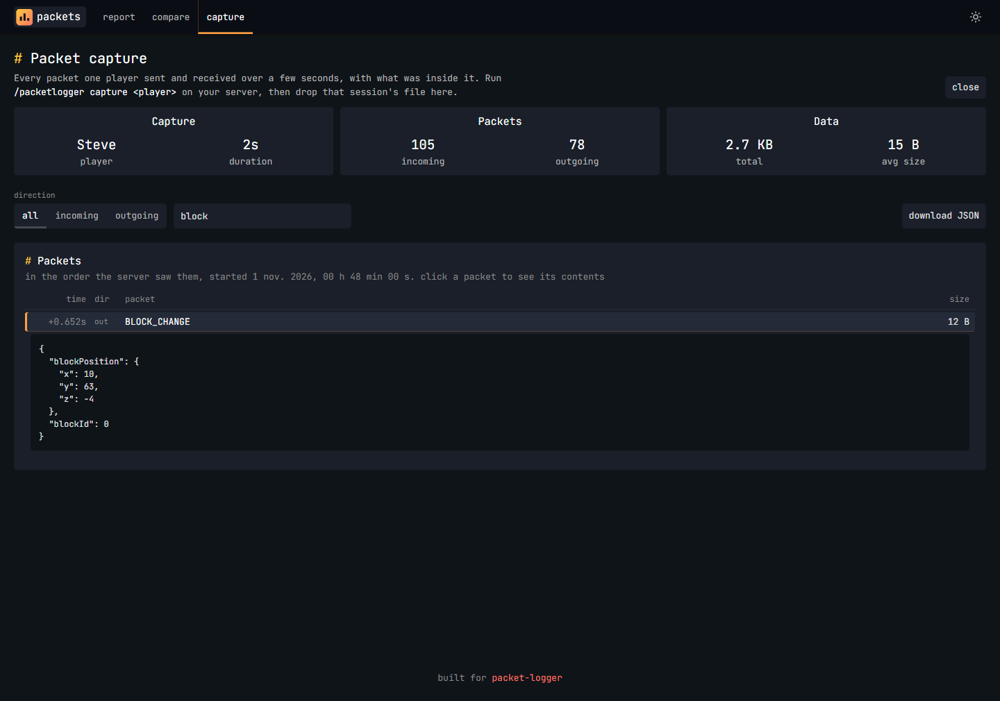

# packet-logger

packet-logger is a plugin that simply tracks the packets coming and going from your server and
displays it in a digestible and easy graph.

---

### 🛠 How Does It Work?
packet-logger collects anonymous packet data from your server and the clients connected to your server
which is then saved into a SQLite file every 5 seconds by default.

You can then simply download the SQLite file and open it on [packets.cosmos.rip](https://packets.cosmos.rip)
or parse it using the provided Python script to analyze the amount of packets and size of those packets.

---

### 🌐 Analyze Using the Web Viewer
The easiest way to look at your data is [packets.cosmos.rip](https://packets.cosmos.rip). Drag and drop your
SQLite file onto the page and you'll get an overview of your packets: totals, packets per second, a timeline you
can drag across to zoom into a timeframe, and a breakdown of every packet type split into incoming and outgoing.

You can find your SQLite files in `plugins/packet-logger/<date>/packets_<time>.sqlite`. Each server start creates a
new file, and you can drop several at once to combine them into one report.

Want to test a change? The **compare** page takes a "before" and an "after" recording and shows how much each packet
type went up or down per second.


---

### 🔎 Capture a Player's Packets
The packet counts show how many packets go in and out and how big they are, but not what's inside them. When you need
the contents, for example to find out what's behind a spike in your report or to debug a plugin, you can capture one
player's packets:

```
/packetlogger capture <player> [count]
```

This saves the next `count` packets that player sends and receives, 200 by default and up to 5000, with each one decoded
into JSON. Once the count is reached, the player leaves or the server stops, the capture is written to the same SQLite
file as your counts, `plugins/packet-logger/<date>/packets_<time>.sqlite`, and you're sent the file's full path so you
know which one to grab. You need the `packetlogger.capture` permission, which ops have by default.

To look at it, drop that file on the **capture** page of [packets.cosmos.rip](https://packets.cosmos.rip/#/capture).
You can go through the packets in order, filter them by direction or name, open any packet to see its contents, or
download the whole capture as JSON.

> [!NOTE]
> Mob and player movement adds up fast, so 200 packets can be less than a second of play. Use a bigger count if you
> want to catch something you do by hand. Packets that PacketEvents can't decode are saved as raw hex instead.

> [!IMPORTANT]
> Captures are meant for looking into something specific, like one player's lag or a plugin sending more than it
> should. Unlike the packet counts, which are anonymous totals, a capture holds the actual contents of that player's
> packets, chat messages included. So capture only when you need to, and don't post capture files publicly.



---

### 🐍 Analyze Using the Python Script
> [!NOTE]
> This script was tested with Python 3.11.4 and Plotly 5.24.1

To analyze your data simply use the [Python Script](https://raw.githubusercontent.com/DebitCardz/packet-logger/refs/heads/main/scripts/graph.py) 
to parse your SQLite file. And use `pip install plotly` so we can create the graphs.

Execute your Python Script by using `python <script>.py --file <file>` or place your script
in the same directory as your SQLite file and rename your SQLite file to `packet.sqlite` for it to parse.

After you've executed the command you'll be prompted to enter whether you want to see all packets, only incoming or only outgoing then
whether you want to see the packets every minute or every hour. After that it'll parse the SQLite file and you'll be greeted
with a visualized representation of your server and client packets.

